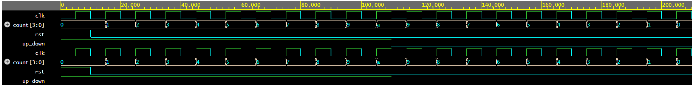

# Major Project 2 - UART TX/RX Loopback Using Verilog

## Description
This project implements UART TX/RX Loopback using Verilog. The Transmitter sends 8-bit serial data and the Receiver receives the same data back through loopback.

It is designed using Finite State Machine (FSM) logic and verified through simulation.

## How it Works?
- **TX** - Transmitter sends 8-bit data serially
- **RX** - Receiver receives 8-bit data serially
- **Loopback** - TX output is connected directly to RX input
- **Start Bit** - Transmission starts with Start Bit (0)
- **Data Bits** - 8 Data Bits are sent one by one
- **Stop Bit** - Transmission ends with Stop Bit (1)

Operations change based on Data:
TX Sends A5 -> RX Receives A5 -> TX Sends 3C -> RX Receives 3C

## Modules
- `design.sv` - UART TX/RX Loopback design
- `testbench.sv` - Testbench for verification
- `testbench.sv` 

## Simulation
- Tool: EDA Playground (Icarus Verilog + GTKWave)
- TX Data given, RX Data correctly received
- Waveform verified successfully

## Waveform

## Tools Used
- SystemVerilog HDL
- EDA Playground
- GTKWave

## Author
Muvva Esther Rani

B.Tech - Electronics and Communication Engineering
